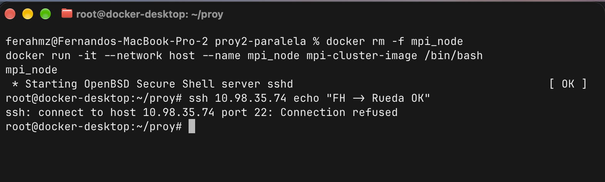
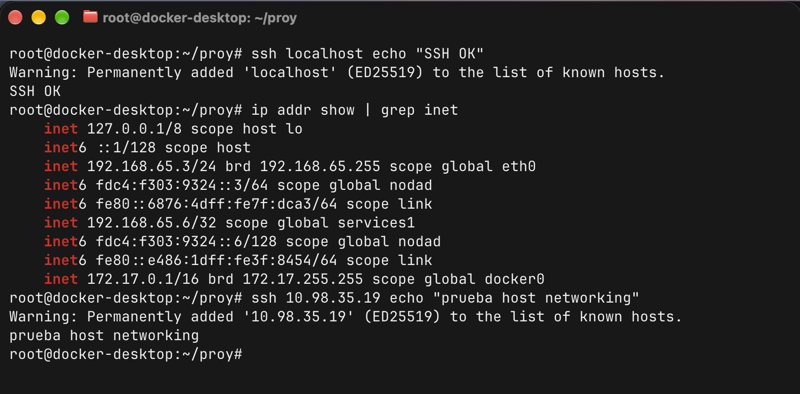

# Troubleshooting — Docker Desktop en macOS no expone el contenedor en la LAN

## Contexto

El equipo está formado por **tres máquinas macOS** conectadas al mismo router
(subred `10.98.35.0/24`). El objetivo era levantar en cada una un contenedor con
`--network host` para que el Nodo Maestro abriera sesiones SSH hacia los Workers
y lanzara el ataque MPI distribuido.

La conectividad entre las máquinas físicas estaba comprobada (ping ✅ entre los
tres hosts), pero el clúster no se pudo armar. Esta es la documentación del por
qué, que es justamente el *troubleshooting* que pide la sección V y la discusión
de la sección VI.

## El síntoma

Desde dentro del contenedor (levantado con `--network host` y con "Enable host
networking" activado en Docker Desktop), se intentó alcanzar el puerto 22 por la
IP física de la LAN del propio Mac:

```
root@docker-desktop:~/proy# ssh 10.98.35.74 echo "FH -> Rueda OK"
ssh: connect to host 10.98.35.74 port 22: Connection refused
```



En cambio, dentro del mismo contenedor, el SSH a `localhost` **sí** funciona:

```
root@docker-desktop:~/proy# ssh localhost echo "SSH OK"
SSH OK
```

Es decir: el demonio `sshd` está corriendo correctamente, pero **solo es
alcanzable desde adentro del contenedor, no desde la IP de la red física**.

### Evidencia definitiva: el contenedor no está en la LAN

Listando las interfaces del contenedor se ve que **ninguna tiene una IP de la
subred física `10.98.35.0/24`**:

```
root@docker-desktop:~/proy# ip addr show | grep inet
    inet 127.0.0.1/8 scope host lo
    inet 192.168.65.3/24 brd 192.168.65.255 scope global eth0
    inet 192.168.65.6/32 scope global services1
    inet 172.17.0.1/16 brd 172.17.255.255 scope global docker0
```



El contenedor vive en la **subred interna de la VM de Docker** (`192.168.65.0/24`)
y en el bridge `docker0` (`172.17.0.0/16`) — exactamente las interfaces virtuales
contra las que advierte la sección V. Su IP real **no** es `10.98.35.74`.

### Matiz: la salida (outbound) sí funciona, la entrada (inbound) no

En la misma sesión, un SSH *saliente* hacia otro nodo del equipo **sí** se
completó:

```
root@docker-desktop:~/proy# ssh 10.98.35.19 echo "prueba host networking"
prueba host networking
```

Esto no contradice la falla, la precisa:

- **Outbound (salir):** el contenedor puede alcanzar la LAN, porque la VM de
  Docker hace NAT a través del Mac. Por eso llega a `10.98.35.19`.
- **Inbound (entrar):** nadie puede alcanzar *este* contenedor desde la LAN, como
  prueba el *Connection refused* a la propia IP `10.98.35.74`.

MPI distribuido necesita que el **Maestro entre por SSH a cada Worker** (tráfico
*inbound* hacia los contenedores de los workers). Ese es justo el sentido que
está bloqueado, así que el poder salir no ayuda: el clúster no se arma.

> El SSH a `10.98.35.19` funciona porque ese host tiene un `sshd` alcanzable
> (probablemente el *Remote Login* nativo del macOS, no el del contenedor). Pero
> los procesos MPI corren **dentro del contenedor**, que sigue siendo
> inalcanzable, de modo que esa vía tampoco arma el clúster.

## La causa

En Linux, `--network host` hace que el contenedor comparta directamente la pila
de red del equipo: el `sshd` del contenedor queda escuchando en la IP real de la
LAN y cualquier otra máquina lo alcanza.

En **macOS (y Windows) Docker Desktop no corre los contenedores sobre el sistema
operativo anfitrión**, sino dentro de una **máquina virtual Linux** interna (por
eso el hostname del contenedor es `docker-desktop` y no el nombre del Mac). La
opción "Enable host networking" conecta el contenedor con la red *de esa VM*, no
con la interfaz física del Mac. Como consecuencia:

- El contenedor obtiene una IP interna de la VM (p. ej. `192.168.65.x`), **no**
  la IP de la LAN (`10.98.35.74`).
- El puerto 22 del contenedor queda publicado dentro de la VM, pero **no en la
  interfaz física**. Por eso `ssh 10.98.35.74:22` responde *Connection refused*:
  en la IP del Mac no hay nada escuchando (el `sshd` real del contenedor está
  escondido en la VM).
- Desde otra máquina del equipo, `ssh 10.98.35.74` cae en el mismo vacío: el
  contenedor es **inalcanzable desde la red física**.

Esto rompe el requisito central de MPI distribuido: el Nodo Maestro necesita
abrir SSH hacia cada Worker, y los Workers en Mac/Windows simplemente no son
alcanzables.

## Reproducción (para FH y Felipe)

Para documentar que la falla es sistemática del equipo y no un caso aislado,
cada integrante reprodujo la misma prueba. Dentro de su contenedor:

```bash
# 1. Confirmar que el sshd del contenedor funciona localmente
ssh localhost echo "SSH OK"

# 2. Ver la IP que realmente tiene el contenedor (NO es la de la LAN)
ip addr show | grep inet

# 3. Intentar alcanzar el puerto 22 por la IP física del propio Mac
#    (reemplazar por la IP LAN de cada quien)
ssh 10.98.35.XX echo "prueba host networking"
#    -> Resultado esperado: Connection refused
```

| Nodo | IP LAN | `ssh localhost` | `ssh <IP-LAN>:22` |
|---|---|---|---|
| FH (maestro) | 10.98.35.19 | OK | Connection refused |
| FR (Rueda) | 10.98.35.74 | OK | Connection refused |
| FA (Felipe) | 10.98.35.210 | OK | Connection refused |

> Completar las columnas con el resultado real de cada quien y adjuntar la
> captura de cada máquina en `evidencia/`.

## Qué demuestra y a qué preguntas responde

- **VI.1 (por qué MPI se congela):** aunque aquí el error es explícito
  (*Connection refused*), la raíz es la misma familia de problema que el *MPI
  hang*: OpenMPI ve interfaces que no enrutan hacia los otros nodos (las
  virtuales de la VM de Docker) y el tráfico nunca llega al destino físico.
- **VI.2 (problemas de red enfrentados):** el aislamiento de red de Docker
  Desktop en macOS/Windows, que no publica el contenedor en la LAN aun con host
  networking activado.
- **VI.5 (retos de HPC con hardware heterogéneo):** interconectar hardware
  heterogéneo (todos Mac en este caso) choca con capas de virtualización que
  rompen la premisa de "una sola red plana". Un administrador de HPC real
  exigiría nodos Linux nativos o redes dedicadas, no laptops con Docker Desktop.

## Conclusión y plan

El run distribuido físico **no es posible con Docker Desktop sobre macOS**: el
contenedor queda encapsulado en la VM interna y es inalcanzable desde la red del
router. Para obtener la evidencia del Paso B (varias IPs participando) se requiere
que los nodos alcanzables sean **Linux con IP real en la LAN**; en un equipo
all-Mac, la vía es una **VM Linux en modo puente (bridged)** por máquina, donde
`--network host` sí expone el contenedor en la subred física.
