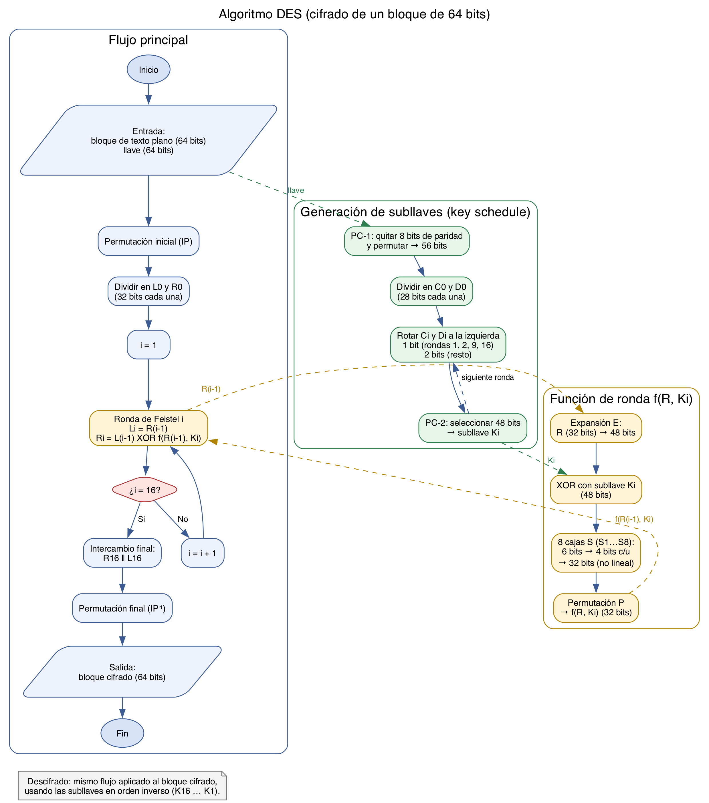

# Tarea 2 — Diagrama de flujo del algoritmo DES



Fuente editable: [`des_flujo.dot`](des_flujo.dot) (Graphviz). Para regenerar las imágenes:

```bash
dot -Tpng -Gdpi=200 des_flujo.dot -o des_flujo.png
dot -Tsvg des_flujo.dot -o des_flujo.svg
```

## Cómo leer el diagrama

- **Flujo principal (azul):** permutación inicial, división en mitades, 16 rondas de Feistel controladas por el contador `i`, intercambio final y permutación inversa.
- **Generación de subllaves (verde):** a partir de la llave se obtienen 16 subllaves de 48 bits (`K1 … K16`), una por ronda.
- **Función f (amarillo):** expansión, XOR con la subllave, cajas S y permutación P. Recibe `R(i-1)` y devuelve el valor que se combina con `L(i-1)`.
- **Descifrado:** es el mismo flujo, pero con las subllaves en orden inverso (`K16 … K1`).

Los pasos están detallados en [des.md](des.md).
