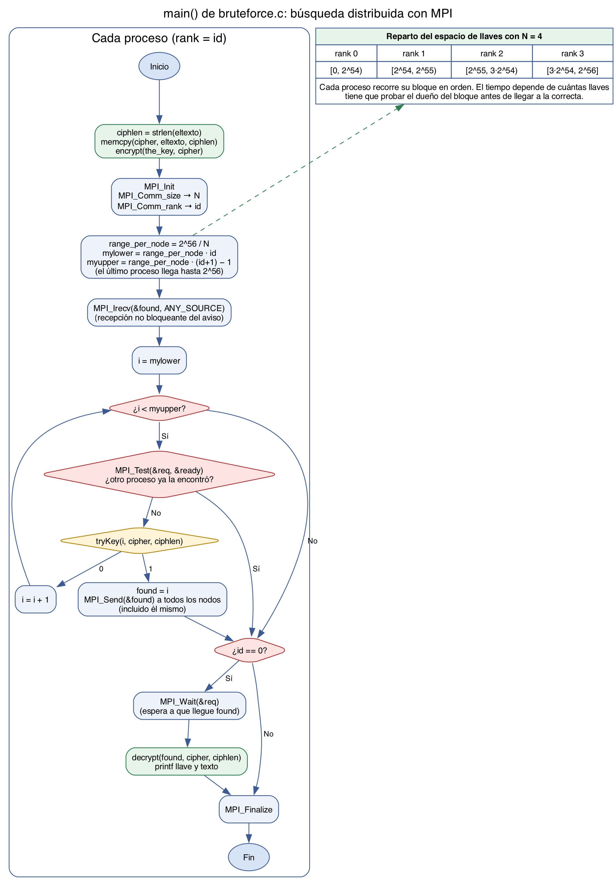
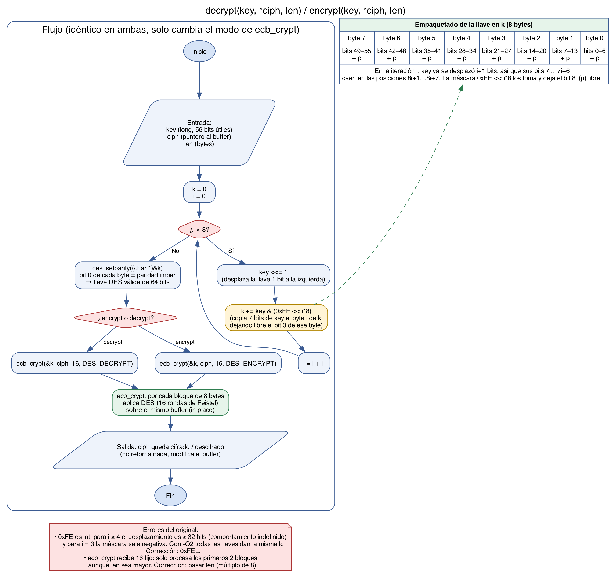
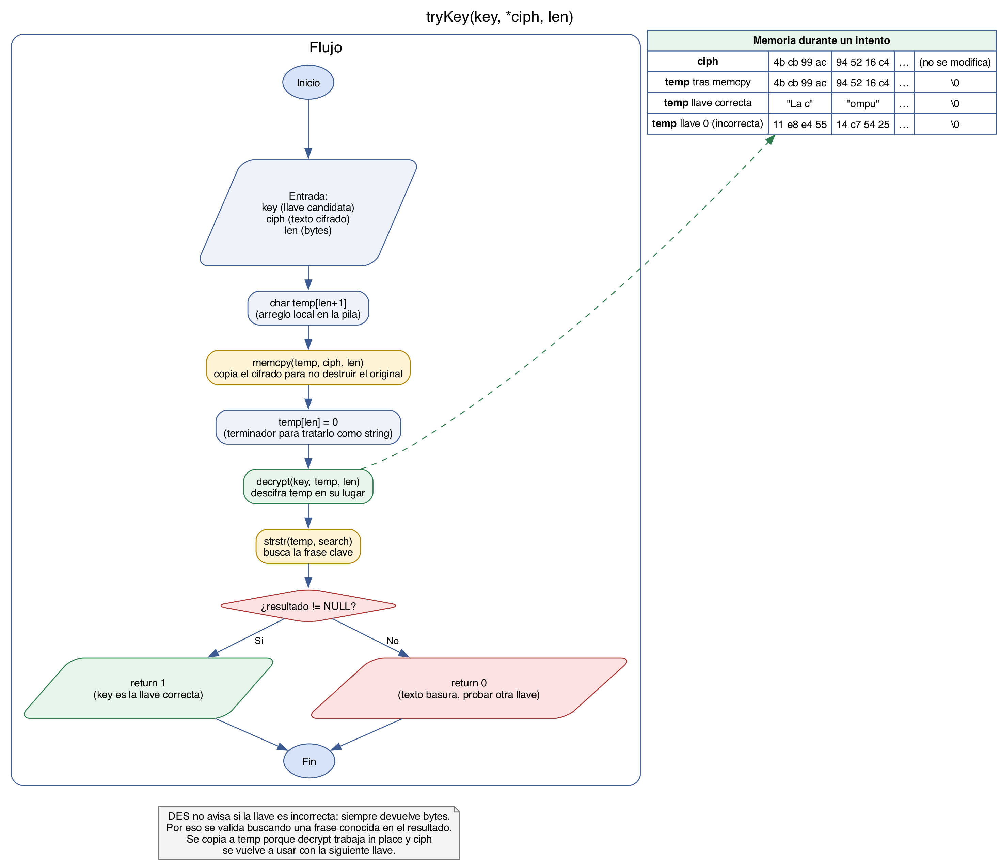

# Tarea 5 (1 y 2) — `decrypt`/`encrypt`, `tryKey` y su uso en el programa

Los diagramas describen las funciones tal como están en [`src/bruteforce.c`](../../src/bruteforce.c). Los errores que encontramos están marcados en rojo, y la versión corregida está en [`src/des_util.h`](../../src/des_util.h).

## El programa completo



`main` cifra `eltexto` con `the_key` antes de iniciar MPI. Luego cada proceso calcula su bloque contiguo de llaves, `[id · 2^56/N, (id+1) · 2^56/N)`, y deja abierta una recepción no bloqueante (`MPI_Irecv`) para enterarse si otro proceso encuentra la llave. En cada iteración revisa con `MPI_Test` si ya llegó ese aviso y, si no, prueba la llave con `tryKey`. El proceso que la encuentra hace `MPI_Send` a todos los demás (incluido él mismo, para completar su propio `Irecv`). Al final, el proceso 0 espera con `MPI_Wait`, descifra e imprime el texto.

## `decrypt(key, *ciph, len)` y `encrypt(key, *ciph, len)`



Las dos funciones hacen lo mismo y solo cambia el modo que reciben en `ecb_crypt`:

1. **Convertir el número `key` en una llave DES.** DES usa 64 bits, pero solo 56 son efectivos: el bit menos significativo de cada byte es de paridad. El ciclo de 8 iteraciones toma 7 bits de `key` por cada byte de `k`. En la iteración `i`, `key` ya se desplazó `i+1` posiciones, y la máscara `0xFE << i*8` toma los bits 1–7 del byte `i` y deja libre el bit 0.
2. **`des_setparity`** llena ese bit 0 de cada byte para que el byte tenga paridad impar, como lo exige el estándar.
3. **`ecb_crypt`** aplica DES en modo ECB: cada bloque de 8 bytes se cifra o descifra de forma independiente con la misma llave, sobre el mismo buffer (*in place*). Las funciones no retornan nada; el resultado queda en `ciph`.

Errores del original: la máscara `0xFE` es `int`, así que para `i ≥ 4` el desplazamiento no está definido (con `-O2` todas las llaves producen la misma `k`). Además, a `ecb_crypt` se le pasa `16` en lugar de `len`, por lo que solo se procesan los primeros dos bloques del texto. El parámetro `len` de `decrypt` se recibe, pero no se usa.

## `tryKey(key, *ciph, len)`



`tryKey` responde a la pregunta "¿es `key` la llave correcta?":

1. Reserva `temp[len+1]` en la pila y copia ahí el texto cifrado con `memcpy`. Es necesario copiarlo porque `decrypt` modifica el buffer y `ciph` se tiene que reutilizar con la siguiente llave.
2. Pone `temp[len] = 0` para que `temp` sea un string válido de C.
3. Descifra `temp` con la llave candidata.
4. Busca la frase clave con `strstr`. DES no da ningún error con una llave incorrecta, solo produce bytes sin sentido, así que la única forma de saber si acertamos es encontrar en el resultado un texto que conocemos.

En la tabla del diagrama se ven los primeros bytes reales de nuestro [`texto_cifrado.bin`](../../datos/texto_cifrado.bin) descifrados con la llave correcta (`3141592`) y con la llave `0`.

Para regenerar las imágenes:

```bash
for f in programa encrypt_decrypt trykey; do dot -Tpng -Gdpi=200 $f.dot -o $f.png; dot -Tsvg $f.dot -o $f.svg; done
```
