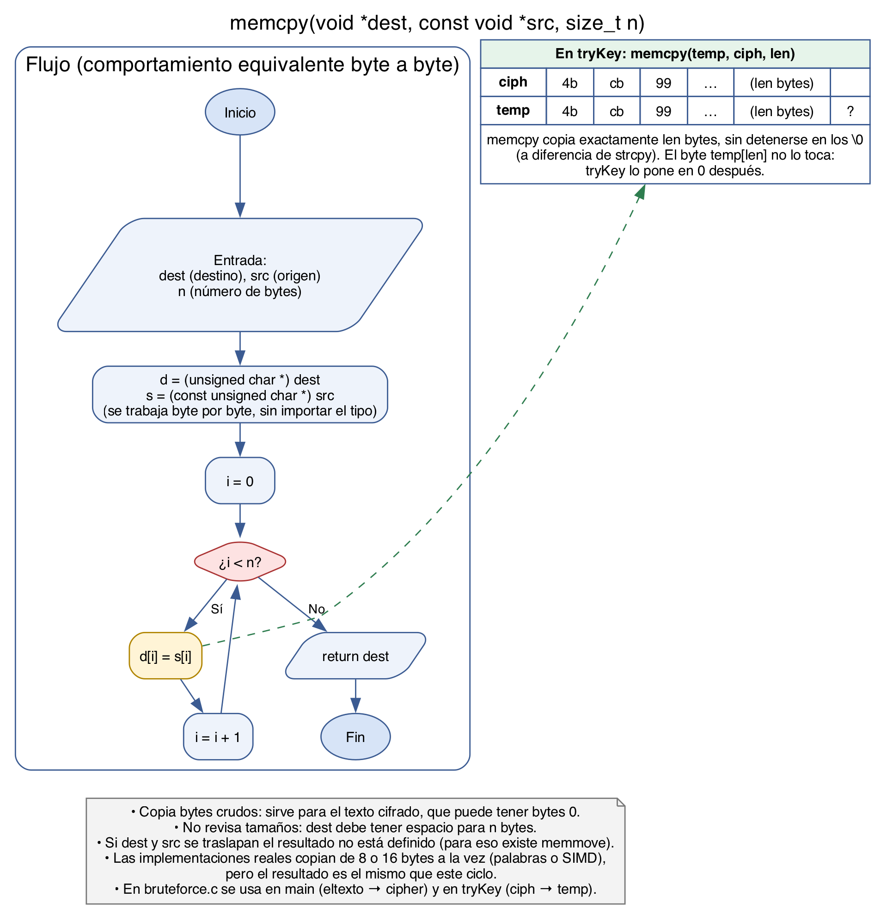
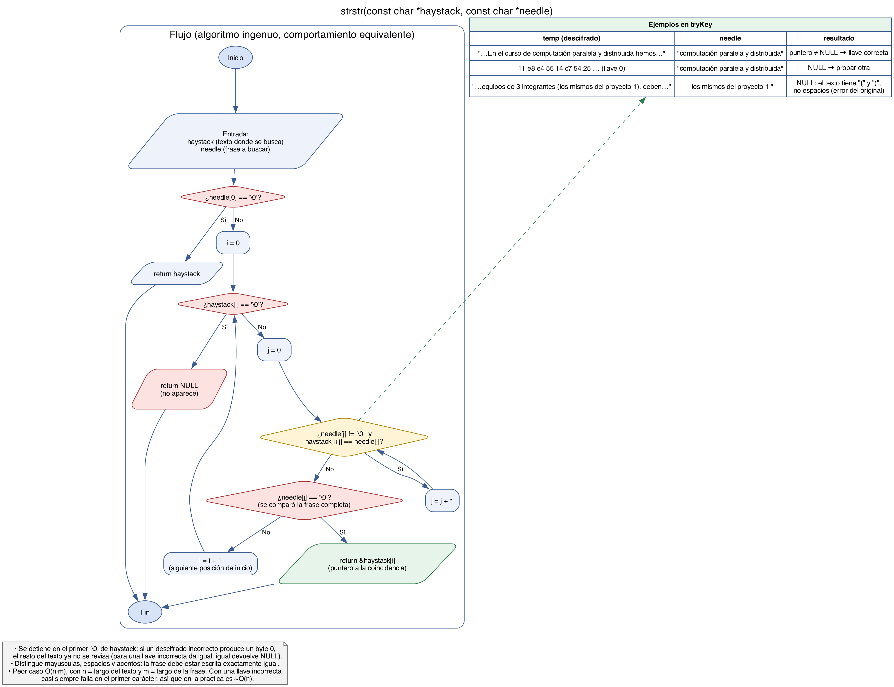

# Tarea 5 (3 y 4) — `memcpy` y `strstr`

Estas funciones son de la biblioteca estándar de C (`<string.h>`). Los diagramas muestran un algoritmo con el mismo comportamiento que las implementaciones reales, que están más optimizadas pero dan el mismo resultado.

## `memcpy(dest, src, n)`

Copia exactamente `n` bytes de `src` a `dest` y devuelve `dest`. Trabaja con bytes sin importar el tipo de los punteros (`void *`) y, a diferencia de `strcpy`, **no se detiene en los `\0`**. Eso es lo que hace falta para el texto cifrado, porque DES puede producir bytes en 0 en cualquier posición.

En `bruteforce.c` se usa dos veces:

- En `main`, `memcpy(cipher, eltexto, ciphlen)` copia el texto plano a un buffer que luego se cifra con `encrypt`, sin modificar `eltexto`.
- En `tryKey`, `memcpy(temp, ciph, len)` crea una copia del cifrado en cada intento. Como `decrypt` modifica el buffer en su lugar, descifrar directamente sobre `ciph` dejaría el cifrado arruinado para la siguiente llave.

`memcpy` no valida tamaños ni permite que las regiones se traslapen (para eso está `memmove`). En `tryKey` esto no es problema porque `temp` mide `len+1` y es un arreglo distinto a `ciph`.

## `strstr(haystack, needle)`

Busca la primera aparición del string `needle` dentro de `haystack`. Devuelve un puntero al inicio de la coincidencia, o `NULL` si no la encuentra. El algoritmo prueba cada posición `i` de `haystack` como posible inicio y compara carácter por carácter con `needle`. Si llega al `\0` de `needle`, la frase completa coincide.

En `tryKey` es el criterio para decidir si una llave es la correcta: `strstr(temp, search) != NULL`. Hay tres cosas a tomar en cuenta:

- **La comparación es exacta.** Distingue mayúsculas, espacios y signos. Por eso el `bruteforce.c` original nunca encuentra la llave: busca `" los mismos del proyecto 1 "` con espacios, pero en el texto la frase está entre paréntesis.
- **Se detiene en el primer `\0`.** Por eso `tryKey` agrega `temp[len] = 0`, y por eso al cifrar nuestro texto rellenamos con espacios y no con ceros.
- **El costo con llaves incorrectas es bajo.** El peor caso es O(n·m), pero con texto basura la comparación falla casi siempre en el primer carácter. El costo de cada intento lo domina `decrypt`, no `strstr`.
