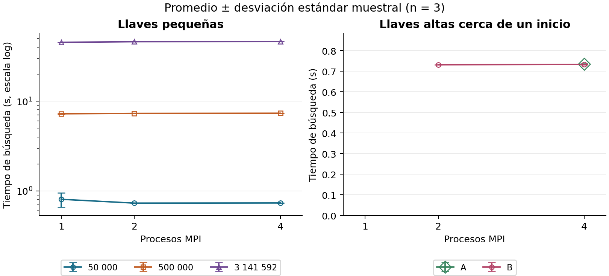
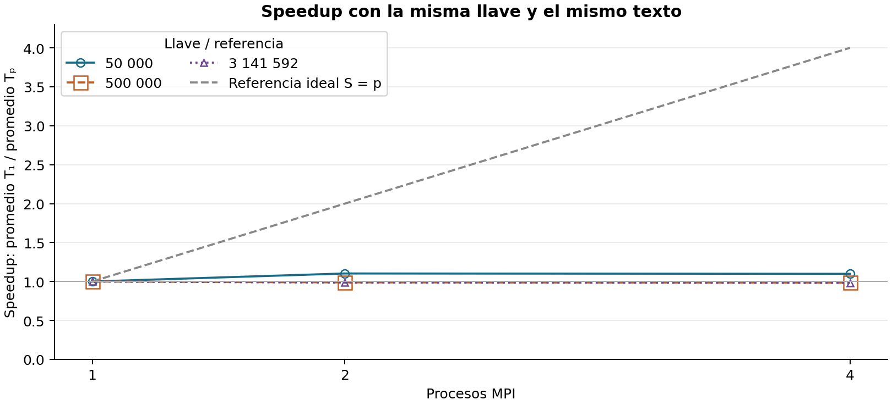

# Resultados medidos

Repeticiones por combinación: 3. DE: desviación estándar muestral.

| Llave | np | Ganador | Intentos del ganador | Media (s) | DE (s) | Speedup | Eficiencia |
|---|---:|---:|---:|---:|---:|---:|---:|
| 50 000 | 1 | 0 | 50,001 | 0.8070 | 0.1475 | 1.000 | 100.0 % |
| 50 000 | 2 | 0 | 50,001 | 0.7317 | 0.0010 | 1.103 | 55.1 % |
| 50 000 | 4 | 0 | 50,001 | 0.7346 | 0.0028 | 1.099 | 27.5 % |
| 500 000 | 1 | 0 | 500,001 | 7.2364 | 0.0449 | 1.000 | 100.0 % |
| 500 000 | 2 | 0 | 500,001 | 7.3185 | 0.0171 | 0.989 | 49.4 % |
| 500 000 | 4 | 0 | 500,001 | 7.3472 | 0.0098 | 0.985 | 24.6 % |
| 3 141 592 | 1 | 0 | 3,141,593 | 45.3373 | 0.0690 | 1.000 | 100.0 % |
| 3 141 592 | 2 | 0 | 3,141,593 | 46.0129 | 0.0075 | 0.985 | 49.3 % |
| 3 141 592 | 4 | 0 | 3,141,593 | 46.1428 | 0.1464 | 0.983 | 24.6 % |
| A | 4 | 1 | 50,001 | 0.7360 | 0.0016 | N/D | N/D |
| B | 2 | 1 | 50,001 | 0.7318 | 0.0002 | N/D | N/D |
| B | 4 | 2 | 50,001 | 0.7337 | 0.0014 | N/D | N/D |

A = 2^54 + 50000 = 18014398509531984; B = 2^55 + 50000 = 36028797019013968.
N/D: no se ejecutó la base con un proceso; no corresponde calcular speedup ni eficiencia.

En la izquierda el eje vertical es logarítmico; en la derecha es lineal.
Los puntos ausentes no representan tiempo cero: son combinaciones omitidas.

El speedup es el cociente de promedios, no el promedio de cocientes. La línea ideal es solo una referencia.
Las barras de tiempos muestran dispersión entre repeticiones, no intervalos de confianza.
